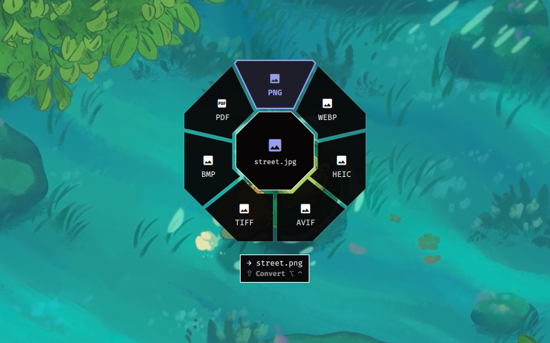

# Quicky for Omarchy



A [Tangerine](https://tangerineformac.com/)-style offline file converter for
Omarchy. It opens a wheel at your cursor where you can convert, compress, merge,
or act on files. Everything runs locally and nothing is uploaded.

It's an Omarchy shell `overlay` plugin, so it uses your theme's menu colors,
border, font, and corner radius, and retints when you run `omarchy-theme-set`.

## Use

In **Files**, select one or more files and press **Super+Alt+C** (or **F4**).
The wheel opens at your cursor with your selection loaded. You don't need to
copy anything first.

Anywhere else, **Super+Alt+C** opens the wheel on files you copied. To drag
files in instead, start dragging first, then press **Super+Alt+C**. The wheel
opens under your cursor, and you drop onto a segment.

The wheel is a sharp-edged octagon. Segments are separated by your Hyprland
gaps, so it looks like a loop of tiled windows. Point in a direction to pick a
segment; you never have to hit the label exactly.

| Input | Does |
| --- | --- |
| Point / ← → | Pick a segment |
| Click / Enter / 1–9 | Run it |
| **Shift** / **Alt** / **Ctrl** | Switch to Convert / Tools / Actions (one tap) |
| Scroll / Tab / ↑ ↓ | Cycle through the wheels |
| Drop files on a segment | Run that segment on them immediately |
| Esc / click anywhere else / right-click | Close |

A tooltip under the wheel shows exactly what you'll get, for example
`Convert to WEBP → photo.webp`, with the wheel keys listed below it. Alt is
used where Tangerine uses ⌘: it sits in the same place on the keyboard, and
Super belongs to Hyprland.

### Sound

Moving between segments plays a soft detent tick, switching wheels plays a
lower one, and running an option plays a double detent. The sounds are
synthesized by `sounds/make-sounds.sh`; edit and rerun it to change them.

To use your own sounds, put `tick.wav`, `shift.wav`, or `run.wav` in
`~/.config/omarchy/quicky/sounds/`. They replace the bundled sounds the next
time the wheel opens.

```bash
quicky sounds off   # or: on
```

## Formats

| Kind | Converts to |
| --- | --- |
| Images (jpg, png, webp, heic, avif, tiff, bmp, svg, ico) | png, jpg, webp, heic, avif, tiff, bmp, pdf |
| GIF | png, mp4, webm |
| Video (mp4, mov, mkv, webm, avi, wmv, …) | mp4, mov, mkv, webm, avi, wmv, gif, mp3 |
| Audio (mp3, m4a, wav, flac, ogg, opus, aiff, wma, …) | mp3, m4a, wav, flac, ogg, opus, aiff, wma |
| PDF | docx, md, txt, pptx, png, jpg (one image per page, 300 DPI) |
| Documents (docx, odt, rtf, txt, html, md) | pdf, docx, md, txt, html, odt, png, jpg |
| Slides (pptx, ppt, odp) | pdf, pptx, odp, png, jpg |
| Sheets (xlsx, xls, ods, csv, tsv) | pdf, xlsx, ods, csv, tsv |
| Subtitles (srt, vtt) | srt, vtt, txt |
| Archives (zip, 7z, tar, rar, …) | zip, 7z, tar, tar.gz |

Not supported: EPUB output (needs Calibre) and Apple Pages.

## Tools

Each kind of file gets its own hand-picked Tools wheel, in the same order
Tangerine uses (`docs/tangerine-features.md` has the full reference). A
selection of several files gets the tools that make sense for a batch.

| Selection | Tools wheel, clockwise from the top |
| --- | --- |
| One image | Compress, Metadata, Edit, Annotate, Add BG, Crop, Redact |
| One video | Compress, Metadata, Mute, Trim, Crop, Speed, Snapshot, Split, Redact |
| One audio file | Compress, Metadata, Normalize, Visualize, Trim, Channels, Bleep |
| One PDF | Compress, Metadata, Split, Organize |
| One archive | Extract |
| Anything else | Metadata |
| Several images | Compress, Create PDF, Collage |
| Several videos / audio files | Compress, Join |
| Several PDFs | Compress, Merge |

Three tools run straight away: Mute (drops the audio track), Split for PDFs
(one PDF per page), and Extract (unpacks into a folder). Every other tool
opens its editor app.

## Actions

Send (LocalSend), Float, Copy, Move, Path, Terminal, Zip, Trash. Move asks
for a folder; Zip packs the selection into one `.zip`.

The tools behind it are ImageMagick, ffmpeg, LibreOffice, poppler, ghostscript,
qpdf, 7zip, wl-clipboard, LocalSend, and PipeWire's `pw-play` for sounds. A stock Omarchy install ships all of
them.

## Editor apps

Tools that need you to pick something (a range, a region, an order) open a
small standalone editor. They're Rust + GTK4 apps in `apps/`, themed from your
active Omarchy theme, and they work on their own too: from the app launcher,
Files' "Open with", or a terminal.

Every editor uses the same compact frame (`quicky-ui/src/frame.rs`): a narrow
portrait window with the tool name and file at the top, and one primary button
at the bottom (plus Reset where it makes sense). Enter presses the primary
button and Esc closes.

| App | Does |
| --- | --- |
| `quicky-trim FILE` | Keep one section of a video or audio file. Drag the ends; click Start or End to type a timecode. Space plays, `,` `.` step frames, I / O set start/end at the playhead, L loops the selection. Audio can also trim silent ends. Writes `-trimmed`. |
| `quicky-compress FILE...` | One file or a selection. Choose Balanced or Strong, optionally shrink images and video, or aim for a target size (MB per file, or % smaller). Writes `-small`. |
| `quicky-join --mode video\|audio\|pdf\|images FILE...` | Put files in order with ▲ ▼, then save one `joined.mp4`, `joined.m4a`, `merged.pdf`, or `images.pdf`. Videos of different sizes and formats are fitted to the first one. |
| `quicky-metadata FILE` | Inspect, edit, or remove a file's metadata (needs ExifTool). Save writes `-edited`, Remove All writes `-clean`. |
| `quicky-crop FILE` | Drag a box or its edges, lock it to 1:1, 16:9, 9:16, 4:3, or 3:4, or type W × H. Writes `-cropped`. |
| `quicky-redact FILE` | Drag boxes over what to hide, choose Solid, Pixelate, or Blur; the preview is what gets saved. Delete removes the selected box. Writes `-redacted`. |
| `quicky-edit FILE` | Light (exposure, brightness, contrast, highlights, shadows, whites, blacks, gamma), Color (temperature, tint, saturation, vibrance, hue), and Detail (clarity, dehaze, grain, noise reduction) sliders with a live preview; each has a ↺. Writes `-edited`. |
| `quicky-annotate FILE` | Arrow, line, text (type straight onto the picture), box, ellipse, pencil, numbered labels, and a magnifier, in six colours and three sizes. Drag an annotation to move it; Ctrl+Z undoes. Writes `-annotated`. |
| `quicky-addbg FILE` | Gradient, colour, or picture (optionally blurred) background, with padding, corners, shadow, and Auto / 1:1 / 16:9 / 4:5. Writes `-bg`. |
| `quicky-collage FILE...` | Grid, row, column, or featured; columns, canvas shape, width, fill or fit, spacing, corners, background, and order. Writes `collage.jpg`. |
| `quicky-crop VIDEO` | The crop editor on a frame of the video, with a scrubber. The sound is kept. |
| `quicky-speed FILE` | 0.25× to 4×, previewed at speed; the sound keeps its pitch. Writes `-2x` and so on. |
| `quicky-snapshot FILE` | Step to a frame, Add Frame, repeat; saves each as `-frame-0m01.50s.png`. |
| `quicky-split FILE` | Add Split at the playhead or Equal clips; writes `-part1`, `-part2`, ... |
| `quicky-redact-video FILE` | Boxes over the playing video, each with its own time track; Solid (any colour), Pixelate, or Blur. Writes `-redacted`. |
| `quicky-normalize FILE` | Target loudness, loudness range, and true-peak limit (−16 LUFS, 11 LU, −1.5 dBTP by default). Writes `-normalized`. |
| `quicky-visualize FILE` | Rounded bars in your accent colour moving with the sound, or a still image; landscape, square, or portrait. Writes `-visual.mp4`. |
| `quicky-channels FILE` | Left and right waveforms with their own ▶, Mono or Stereo output, a volume per side, ▶ Play Output. Writes `-mono` or `-stereo`. |
| `quicky-bleep FILE` | Drag across the Bleep layer to add sections; compare Original and With Bleeps. Writes `-bleeped`. |
| `quicky-organize FILE` | Drag pages to reorder, ↻ to rotate, Reset Order, and "Make all pages the same width". Writes `-organized.pdf`. |

Video plays through an embedded mpv (libmpv), so every format mpv handles
works. Build and install them with:

```bash
apps/install.sh   # ~/.local/bin + launcher entries
```

They float centered via the window rules `quicky setup` installs. Their app
ids are `quicky.*`, deliberately not `org.omarchy.*`, which Omarchy tags as
terminals.

## Install

Quicky needs [Omarchy](https://omarchy.org/) with its Quickshell-based shell, which
has plugin support.

**1. Add the plugin:**

```bash
omarchy plugin add https://github.com/Meshwa428/quicky --enable
```

This clones the repo into `~/.config/omarchy/plugins/meshwa.oma-quicky/` and turns
it on.

**2. Add the Files shortcut and the window rules:**

```bash
~/.config/omarchy/plugins/meshwa.oma-quicky/bin/quicky setup   # Nautilus F4 shortcut + Hyprland window rules
nautilus -q                                                    # restart Files to load it
```

**3. Add the keybinding** to `~/.config/hypr/bindings.lua`:

```lua
o.bind("SUPER + ALT + C", "Quicky", "~/.config/omarchy/plugins/meshwa.oma-quicky/bin/quicky open")
```

**4. Optional: build the editor apps** (Trim, Crop, Annotate, …). These need a Rust
toolchain, plus libmpv and GTK 4, which Omarchy already has:

```bash
omarchy pkg add rustup && rustup default stable     # skip if you already have cargo
~/.config/omarchy/plugins/meshwa.oma-quicky/apps/install.sh
```

### Update

```bash
omarchy plugin update meshwa.oma-quicky
omarchy restart shell                                               # load the new QML
~/.config/omarchy/plugins/meshwa.oma-quicky/apps/install.sh         # if you use the editor apps
```

### Uninstall

```bash
omarchy plugin remove meshwa.oma-quicky
```

Then delete the `SUPER + ALT + C` line from `bindings.lua`. The editor apps live in
`~/.local/bin/quicky-*` and `~/.local/share/applications/quicky.*.desktop`; delete them
too if you built them.

## Develop

The backend works on its own, which makes it easy to test:

```bash
bin/quicky convert webp photo.png
bin/quicky tool compress --preset strong --target-mb 2 clip.mp4
bin/quicky action copy-path file.txt
```

To try changes in the shell, copy the files into
`~/.config/omarchy/plugins/meshwa.oma-quicky/` (plugin folders can't contain
symlinks). The plugin is `keepLoaded`, so QML changes take effect only after
`omarchy-restart-shell`.

### Publishing a change

```bash
omarchy plugin validate .            # the manifest, entry points, no symlinks
git add -A && git commit -m "…"
git push                             # users get it with: omarchy plugin update meshwa.oma-quicky
```

For a release:
1. Bump `version` in `manifest.json` and in `apps/Cargo.toml`.
2. Commit, then tag and push the tag:
   ```bash
   git tag v0.2.0 && git push --tags
   ```
3. `gh release create v0.2.0 --generate-notes` writes a release page from the commits.

## How it reads the Files selection

Wayland doesn't let one app read another app's selection. Instead,
`quicky setup` installs a Nautilus script bound to F4, and Nautilus passes the
selected paths to it. When Files is focused, Super+Alt+C just sends F4 to it
(`hl.dsp.send_key_state` — Hyprland's Lua config takes dispatchers as Lua). Your clipboard is never touched.

## License

MIT. See [LICENSE](LICENSE). Copyright (c) 2026 Meshwa.

Quicky is an independent project. It isn't affiliated with or endorsed by
Tangerine or its makers: the name is used only to describe the style of tool
this is. It calls ImageMagick, ffmpeg, LibreOffice and the other tools listed
above as separate programs, and each keeps its own license.
